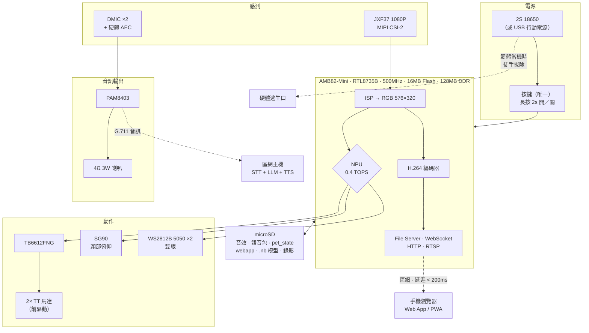
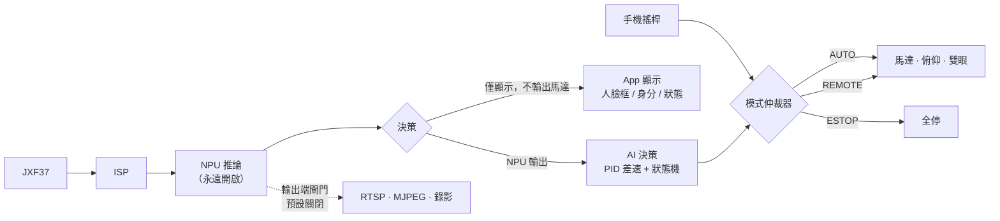

# TAMAZOO — "Fully On-Device AI Desktop Patrol Robot" (全本機 AI 桌面巡邏機器人)

> **Realtek AMB82-Mini（RTL8735B）｜ 0.4 TOPS NPU ｜ 2WD 差速底盤**
>
> 組員：周彧錡、顏益政、陳垣達　｜　繳交日期：2026.10.12 00:00
>
> 詳細計畫 → [PROPOSAL.md](PROPOSAL.md)


> ⚠️ **本專案目前為計畫階段，實作尚未完成。** 成品照片位置已標示，請見 [§6 實作成品](#6-實作成品待補)。

---

## 1. 專案簡介

一隻會**看見你、認得你、跟著你轉**的桌上機器人。
你走開時它會出去找你；朋友來了它知道那是誰，會轉頭看對的人。

**所有視覺推理 100% 在晶片上的 NPU 本地完成** —— 斷網仍可運作，影像一個位元組都不會離開你的房間。

| 一個人的時候 | 兩個人的時候 |
| --- | --- |
| 它轉頭看你、認得你、跟著你轉 | 它知道誰是主人、誰是客人，**轉向正在跟它說話的那個人** |

> **這個功能只有做在本地才做得到。**
> 雲端的語音玩具分不清此刻站在它面前的是誰，因為它沒有持續的身分記憶。
> 我們的 NPU 有這個記憶。

---

## 2. 功能說明

### 2.1 視覺感知 — 多人辨識（本機 NPU）

| 功能 | 說明 |
| --- | --- |
| 人臉偵測 | SCRFD-500m，576×320 輸入，一次輸出多個 bbox |
| 人臉辨識 | MobileFaceNet，112×112 → 128-d 特徵，**最多註冊 4 位成員** |
| 身分判斷 | 已註冊 / 未註冊 / **相似度落在灰區時不亂叫名字** |
| 目標選擇 | 依「已註冊 → 距離 → 移動量 → 最近互動者」評分選出注視目標 |
| 防止抽搐 | 目標切換冷卻 2.5 秒，新目標需超過 20% 分數 |

**資源關鍵**：辨識成本隨人數線性成長，但**模型記憶體不變**（同一個 context 重複呼叫）。
3 張臉的單幀總推論約 25–40 ms。

### 2.2 動作 — 視覺閉環

```
偵測到人臉 ──► 取 bbox 中心 ──► PID 差速解算 ──► PWM ──► 2WD 馬達
                     │
                     └──► 頭部俯仰 SG90
```

| 功能 | 說明 |
| --- | --- |
| 水平對齊 | 差速轉向追人臉，**不需原地轉頭**（更像機器人、機構更簡單） |
| 接近控制 | 以 bbox 大小估算距離，鎖定 30 cm |
| 防止撞人 | **偵測到 ≥ 2 人時自動限速至 40%** |
| 穩定性 | 中值濾波、deadzone、PWM slew rate、轉向速率上限 |

### 2.3 語音 — 兩層設計

```
第一層：語音通訊（P0）—— 純硬體，0 推論，無需伺服器
    麥克風 ⇄ 喇叭        延遲 < 200 ms
    用途：對講、遠端陪伴、傳話筒、語音包點播

第二層：LLM 對話（附加）—— 需要區網主機
    麥克風 → G.711 → 區網 STT → LLM → TTS → 喇叭（＋驅動動作）
    延遲 0.5 – 2.6 s
```

| 功能 | 說明 |
| --- | --- |
| **通話 session** | 撥通後麥克風持續開啟，有接通有掛斷，**不是 push-to-talk**（駕駛時兩隻手都要空著） |
| **語音包快捷鍵** | 點一下機器人就開口：你好／自我介紹／你叫什麼／謝謝／再見／搗蛋 |
| 硬體 AEC | AMB82 內建聲學迴聲消除（`configMicAEC`，0–17 強度可調，16 kHz） |
| 硬體編碼 | **G.711**（非 MP3）—— 無演算法損失、延遲極低、不佔 CPU |
| 用身體填補延遲 | LLM 等待期間「表演思考」：眼神偏移、思考音、預擺動作 |

### 2.4 互動 — 狀態機與養成

```
SOLO 單人 ──偵測到第 2 張臉──► GROUP 多人 ──► 輪流注視 / 禮節規則
   │                              │
   ├─ 黏主人                      ├─ 主人 + 陌生人 → 輪流但不主動靠近
   ├─ 找你模式（你離開 30 秒）    └─ 2 位陌生人 → 好奇張望
   └─ 睡眠（10 分鐘）
```

| 功能 | 說明 |
| --- | --- |
| 每人獨立心情值 | 與小明互動影響「小明的好感度」，不是一個全域數字 |
| 每人獨立對話摘要 | 注入 LLM 的 system prompt 區分「我正在跟誰說話」 |
| 惡作劇音效 | 怪獸咆哮、陰森笑聲、系統錯誤（偽裝當機）—— 100% 離線 |
| 持久化 | 養成天數與心情值存 microSD，重開機記得你養了幾天 |

### 2.5 手機 Web App — 頁面跑在裝置上

| 功能 | 說明 |
| --- | --- |
| **零安裝** | 瀏覽器輸入 `http://<裝置IP>` 即可，**頁面由 AMB82 自己從 microSD 提供** |
| AUTO / MANUAL | 一鍵切換，馬達控制權單一指派、互斥 |
| MANUAL 橫向雙拇指 | **搖桿左、限速左、俯仰右**，影像預覽放大到 44/52 欄 |
| 即時對話 | 駕駛中可同時語音通話 + 點語音包，**不必離開控制頁** |
| 模式仲裁 | `AUTO` / `REMOTE` / `STREAM` / `ESTOP` 互斥，AI 與搖桿不打架 |

### 2.6 配對與連線

```
首次開機 ──► BLE 配對模式 ──► 官方 App 選 AP ──► 連線成功
                                    │
                                    ▼
              瀏覽器開 http://<ip> ──► 直接進入控制頁（零掃描）
```

| 功能 | 說明 |
| --- | --- |
| **BLE WiFi 配網** | 用 Realtek 官方 `BLEWifiConfigService` + 官方 iOS/Android App，**零開發** |
| File Server | 官方 `Read and display HTML file from SD card` 範例 |
| UDP 廣播發現 | 開機前 60 秒密集廣播，App 免手動輸入 IP |
| 影像串流 | RTSP 1080p 與 MJPEG 預覽，**全部預設關閉** |

---

## 3. 系統架構圖

### 3.1 硬體架構



### 3.2 資料流與模式仲裁



> **關鍵設計**：NPU 影像通道**永遠開啟**，串流與錄影是「輸出端」的可選閘門。
> 關掉串流不影響 AI 感知 —— 這讓「預設隱私」不必犧牲本體功能。
>
> **馬達控制權由模式仲裁器單一指派**，自主 AI 與手機搖桿永不打架。

### 3.3 軟體模組結構

```
firmware/
├── main/main.cpp                  狀態機主迴圈
└── modules/                      27 個模組
    ├── camera / nn / face         相機、NPU、人臉（多 bbox）
    ├── social / person_store      多人評分、註冊資料
    ├── motor / servo / led / control  馬達、俯仰、雙眼、PID 差速
    ├── mode                       模式仲裁器
    ├── state / pet_state          自主狀態機、養成持久化
    ├── network / remote           HTTP、WebSocket、dead-man
    ├── stream / recorder          RTSP/MJPEG 閘門、MP4 錄影
    ├── mic / voice / speech       DMIC、G.711、語音包、區網 STT/LLM/TTS
    ├── lan_client / discovery / provision  區網端點、UDP 探測、BLE 配網
    ├── button / power             單鍵多時長（2s/8s，release 判斷）、MOSFET 閘門
webapp/                            部署至 microSD /webapp/
assets/ · docs/ · audio/ · models/ · config/
```

---

## 4. 硬體規格與 BOM

### 4.1 核心規格

| 項目 | 規格 |
| --- | --- |
| 主控 | Realtek AMB82-Mini（RTL8735B） |
| AI 算力 | **0.4 TOPS NPU**（INT8 / INT16） |
| 相機 | JXF37 1920×1080 CMOS（MIPI CSI-2） |
| 影像編碼 | H.264 / H.265 / JPEG（硬體） |
| 音訊 | Audio DAC ×1、ADC ×1、**DMIC ×2**、**硬體 AEC**、G.711/AAC 硬體編碼 |
| 無線 | 雙頻 Wi-Fi 2.4/5GHz（802.11a/b/g/n）+ **BLE 5.1** |
| 儲存 | 16 MB Flash、128 MB DDR2、512 KB RAM、microSD |
| 供電 | 5 V / ≥ 3 A（行動電源或 2S 18650） |

### 4.2 BOM（約 NT$1,505）

| # | 元件 | 規格 | 數量 | 約略成本 |
| --- | --- | --- | --- | --- |
| 1 | AMB82-Mini 開發板 | 含 JXF37 相機 | 1 | — |
| 2 | 直流馬達驅動 | TB6612FNG 雙 H 橋 | 1 | NT$60 |
| 3 | TT 減速馬達 + 輪胎 | 6V 直流 | 2 | NT$120 |
| 4 | 萬向輪 | ø25 mm | 2 | NT$80 |
| 5 | 底盤 | 壓克力 3 mm | 1 | NT$100 |
| 6 | 舵機 | SG90 9 g（**只買 1 顆**） | 1 | NT$100 |
| 7 | 雙眼 RGB | **WS2812B 5050 四腳 ×2** | 2 | NT$40 |
| 8 | 音訊 | PAM8403 + 4Ω 3W 喇叭 | 1 | NT$120 |
| 9 | 麥克風 | MEMS DMIC | 1 | NT$80 |
| 10 | 儲存 | microSD 32 GB | 1 | NT$150 |
| 11 | **使用者按鍵 + 電源閘門** | **單顆 tact switch + N-MOSFET** | 1 | NT$20 |
| 12 | 電池逃生口 | 彈片式 2S 電池座 + 徒手可開蓋板 | 1 | NT$60 |
| 13 | 電源指示 LED | **直接接主電源軌，不經韌體** | 1 | NT$5 |
| 14 | 延遲變換器 ×1 | | 1 | NT$50 |

> **全系統只有 1 顆按鍵**：長按 2 秒後鬆手 = 電源開／關；持續按住 8 秒 = BLE 配網。

### 4.3 AI 模型與資源預算

| 用途 | 模型 | 輸入 | DDR |
| --- | --- | --- | --- |
| 人臉偵測 | `scrfd_500m_bnkps_576x320_u8.nb` | 576×320 | 2.6 MB |
| 人臉辨識 | `mobilefacenet_int8.nb` | 112×112 | 1.72 MB |
| 寵物分類（P1） | `img_class_cnn.nb` | 224×224 | ~0.7 MB |
| **合計** | 全部官方預訓練 `.nb` | | **~5.8 MB / 16 MB（佔 36%）** |

### 4.4 功耗

| 模式 | 平均功耗 | 10000 mAh 續航 |
| --- | --- | --- |
| 睡眠 | ~1.6 W | ~16 h |
| 陪伴 | ~2.0 W | ~13 h |
| 巡邆 | ~4.2 W | ~6 h |
| + RTSP 串流 | ~4.8 W | ~5.4 h |

---

## 5. 使用方式

### 5.1 首次配對

1. **持續按住唯一的按鍵 8 秒** → 雙眼藍色快閃，進入 BLE 配對模式（不需鬆手）
2. 開啟 **Realtek WiFiConfig**（Android）或 **Easy WiFi Config**（iOS）
3. 掃描 → 選擇裝置 → 裝置回傳周邊 AP 清單 → 選 AP、輸入密碼
4. 連線成功 → 雙眼轉綠 → BLE 自動停止廣告

### 5.2 按鍵操作（全系統唯一一顆）

| 操作 | 功能 |
| --- | --- |
| 短按（< 2 秒） | 無動作（僅播放確認音） |
| **長按 2 秒後鬆手** | **電源開／關**（一次全停：馬達、燈光、麥克風、相機） |
| **持續按住 8 秒** | **WiFi 重設 → BLE 配對**（即時觸發，不需鬆手） |

判定方式為**在鬆手時依總按住時長決定**，因此 2 秒與 8 秒不會互相衝突。
按住期間每秒有「滴」聲提示，2 秒與 8 秒各有不同的確認音。

韌體當機無法關機時，**拔除電池／USB 即為硬體逃生口**
（機身底部徒手可開蓋，5 秒內完成）。

### 5.3 開啟控制頁

瀏覽器輸入 `http://<裝置IP>` → AMB82 的 File Server 直接提供頁面 → 可「加入主畫單」。

**零安裝、零上架、無需 Internet。**

### 5.4 手機 App 畫面

**AUTO 模式** — 機器人自己決定怎麼動

```text
┌────────────────────────────────────┐
│ ● TAMAZOO-DESK-01 [ AUTO │ MANUAL ]│
│ 192.168.1.123         ● 已連線 · 續航 13h│
├────────────────────────────────────┤
│ ┌──────────────────────────┐       │
│ │  即時影像預覽            │       │
│ │  （人臉框疊圖）          │       │
│ └──────────────────────────┘       │
│ 偵測 2 張 · 小明 92% · 訪客 71%    │
├────────────────────────────────────┤
│ 狀態          距離      心情       │
│ 陪伴          32 cm     82         │
│                                    │
│ [ 惡作劇 ]  [ 傳話筒 ]  [ 截圖 ]   │
│                                    │
│ 喇叭音量 ─────●───── 60%           │
├────────────────────────────────────┤
│    [控制]      │  語音  │   設定    │
└────────────────────────────────────┘
```

**MANUAL 模式** — 橫向雙拇指，可同時即時對話

```text
┌────────────────────────────────────────────────────┐
│ ● TAMAZOO-DESK-01                 [ AUTO │ MANUAL ]│
│ 192.168.1.123                       ● 通話中  00:42│
├────────────────────────────────────────────────────┤
│ ┌────────────────────────────────────────────┐     │
│ │        即時影像預覽（放大 · 橫向）         │     │
│ │     人臉框疊圖 · 偵測 2 張 · 小明 92%      │     │
│ └────────────────────────────────────────────┘     │
├────────────────────────────────────────────────────┤
│ 限速 ──●──────── 40%     │ 頭部俯仰                │
│                          │ ────────●──────         │
│                          │                         │
│   ╭──────────╮           │      ╭──────╮           │
│  ╱            ╲          │     ╱        ╲          │
│ │       ●      │         │    │    ●     │         │
│  ╲            ╱          │     ╲        ╱          │
│   ╰──────────╯           │      ╰──────╯           │
│ 搖桿 · 左拇指            │ 俯仰滑桿 · 右拇指       │
├────────────────────────────────────────────────────┤
│ 語音包 ▸ 可橫向滑動                                │
│ [你好] [自我介紹] [你叫什麼] [謝謝] [再見] [搗蛋]  │
├────────────────────────────────────────────────────┤
│      [控制]        語音          設定              │
└────────────────────────────────────────────────────┘
```

共 5 個畫面，完整線框見 [PROPOSAL.md §5.3.5.1](PROPOSAL.md)。

---

## 6. 實作成品（待補）

> ⚠️ **本專案為計畫階段，以下照片待實作完成後補上。**

| # | 需要的照片／截圖 | 建議檔名 | 內容要求 | 狀態 |
| --- | --- | --- | --- | --- |
| 1 | 機器人成品 | `assets/robot_photo.jpg` | 完整組裝外觀，含絨毛造型 | ⬜ 待補 |
| 2 | 硬體組裝 | `assets/hardware_assembly.jpg` | 俯視露出底盤、馬達、電池座 | ⬜ 待補 |
| 3 | 開機狀態 | `assets/power_on.jpg` | 雙眼亮起 + 電源指示燈 | ⬜ 待補 |
| 4 | Web App AUTO 頁 | `assets/webapp_auto.png` | 真實瀏覽器截圖 | ⬜ 待補 |
| 5 | Web App MANUAL 頁 | `assets/webapp_manual.png` | **橫向**截圖，含預覽與搖桿 | ⬜ 待補 |
| 6 | 語音包快捷鍵 | `assets/voice_pack.png` | 語音頁截圖 | ⬜ 待補 |
| 7 | 多人辨識結果 | `assets/multi_face.png` | 2–3 張人臉同時被框選並標名 | ⬜ 待補 |
| 8 | 手機 App 錄影 | `assets/demo.gif` | 10 秒內展示追頭 + 認人 + 遙控 | ⬜ 待補 |

**可直接使用的視覺素材**（已內建，不需補）

- 系統架構圖 → [§3 系統架構圖](#3-系統架構圖)（mermaid，GitHub 會直接渲染）
- 硬體方塊圖、資料流圖 → [PROPOSAL.md §5.1–5.2](PROPOSAL.md)
- 手機 App 五個畫面線框 → [§5.3](#53-手機-app-畫面) 與 PROPOSAL.md §5.3.5.1
- 狀態機圖、取捨決策表 → [PROPOSAL.md](PROPOSAL.md)

---

## 7. 與課程範例的差異

對照 [AI-plush-giraffe](https://github.com/rkuo2000/AI-plush-giraffe)：

| 面向 | 課程範例 | **TAMAZOO** |
| --- | --- | --- |
| 語言模型 | `gemma4:e2b` 雲端／邊緣伺服器 | **視覺 100% 本機；語音交給使用者自己的區網主機** |
| 多人辨識 | 無 | **2–3 張臉同時辨識，知道在跟誰說話** |
| LLM 回應 | **只播出聲音** | **解析為結構化意圖，直接驅動馬達／俯仰／雙眼** |
| 影像隱私 | 影像與音訊皆上傳 | **相機影像永不離開裝置，連區網都不送** |
| 等待體驗 | 發呆約 2 秒 | **「表演思考」：眼神偏移、思考音、預擺動作** |
| 記憶 | LLM 無狀態 | **本機注入心情值、養成天數、上一輪對話摘要** |
| 語音延遲 | 雲端 1.4–4.7 s | **語音通訊層 < 200 ms**（純硬體，零推論） |
| 對外介面 | 無 | **Web App 頁面由裝置自帶，零安裝、零上架** |
| 機構 | 靜止絨毛玩具 | **2WD 差速底盤，可移動、限速、防傾覆** |

---

## 8. 文件導覽

| 文件 | 內容 |
| --- | --- |
| **[PROPOSAL.md](PROPOSAL.md)** | 完整計畫：問題定義、系統目標、功能取捨表、系統架構、開發排程、風險與取捨 |
| `docs/architecture.md` | 系統架構與資料流 |
| `docs/wiring.md` | 完整接線表 |
| `docs/assembly.md` | 機構組裝步驟 |
| `docs/calibration.md` | PID / 比例常數標定紀錄 |
| `docs/measure.log` | 延遲與功耗實測數據 |
| `firmware/modules/` | 27 個軟體模組 |
| `webapp/` | 手機控制介面（部署至 microSD `/webapp/`） |

---

## 9. 參考資料

- 作業與課程範例：<https://github.com/rkuo2000/AI-plush-giraffe>
- AMB82-Mini 規格與 Pinout：<https://ameba-doc-arduino-sdk.readthedocs-hosted.com/en/latest/ameba_pro2/amb82-mini/index.html>
- NN 模型轉換：<https://www.amebaiot.com/zh/amebapro2-ai-convert-model/>
- NN 應用與 Model Zoo（含 DDR 用量表）：<https://ameba-doc-rtos-pro2-sdk.readthedocs-hosted.com/en/latest/application_note/14_NN.html>
- BLE WiFi 配網官方範例：<https://ameba-doc-arduino-sdk.readthedocs-hosted.com/en/latest/ameba_pro2/amb82-mini/Example_Guides/BLE/WiFi%20Config%20Service.html>
- 從 SD 卡提供 HTML（Web App）：<https://ameba-doc-arduino-sdk.readthedocs-hosted.com/en/latest/ameba_pro2/amb82-mini/Example_Guides/File%20System/Read%20and%20display%20HTML%20file%20from%20SD%20card.html>
- 硬體 AEC 官方範例：<https://ameba-doc-arduino-sdk.readthedocs-hosted.com/en/latest/ameba_pro2/amb82-mini/Example_Guides/Multimedia/Audio/Echo%20Cancellation.html>
- WS2812B 類別 API（Only SPI MOSI pin is valid）：<https://ameba-doc-arduino-sdk.readthedocs-hosted.com/en/latest/ameba_pro2/amb82-mini/API_Documents/BLE/Class%20BLEWifiConfigService.html>
- RTL8735B 硬體規格：<https://aiot.realmcu.com/en/product/rtl8735b.html>
- 課程 Edge AI 討論（老師）：<https://forum.amebaiot.com/t/amb82-mini-edge-ai-capability/4813>

---

## 10. 聲明

- 本專案為**工程原型**，非經認證的消費性電子產品，不做兒童玩具認證宣稱。
- **不對接任何第三方雲端 AI 服務**。語音服務端點由使用者於 `config.h` 指定，
  可指向完全不通 Internet 的離線主機。
- **相機影像永不離開裝置**；語音功能預設關閉，3 分鐘雙向皆無音訊自動掛斷。
- 登入憑證存放於本機並列入 `.gitignore`，不提交公開 repo。
- 「惡作劇」音效僅供裝置主人逗樂使用，不提供排程定時主動播放功能。